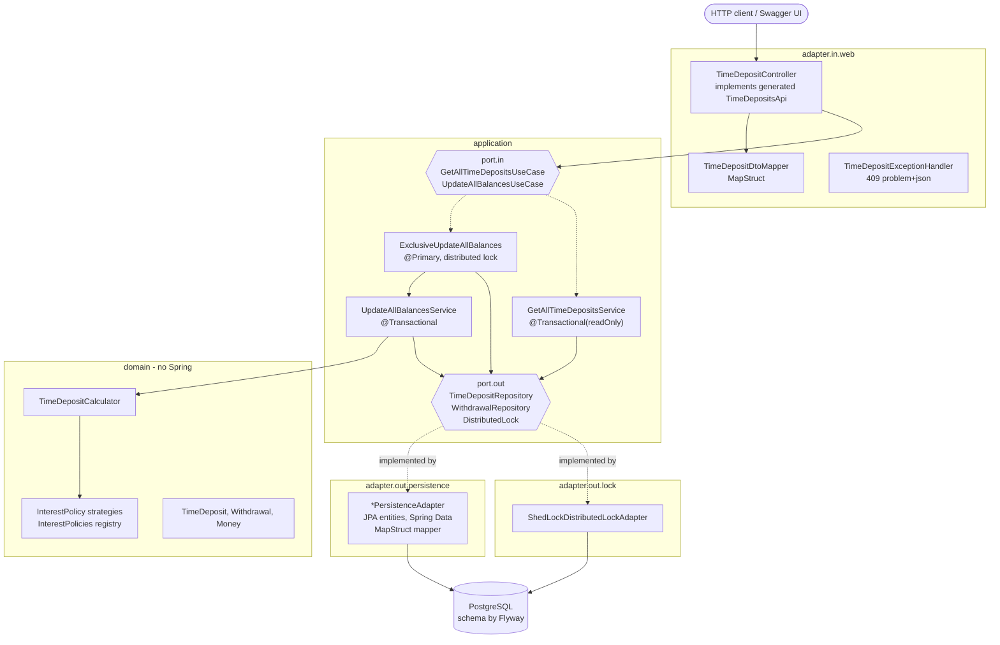
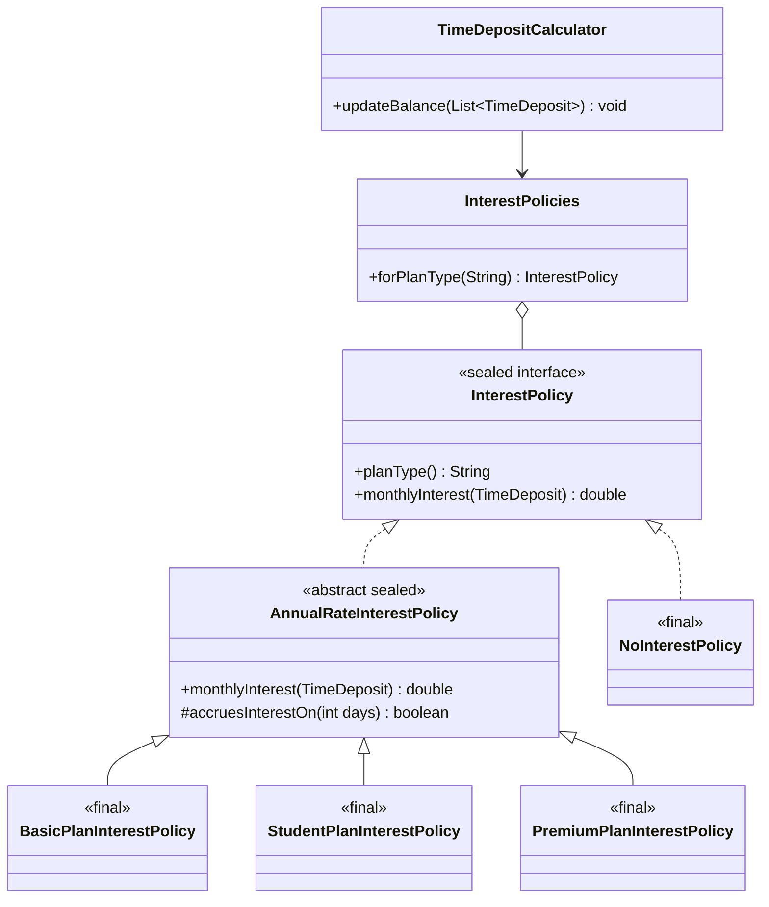
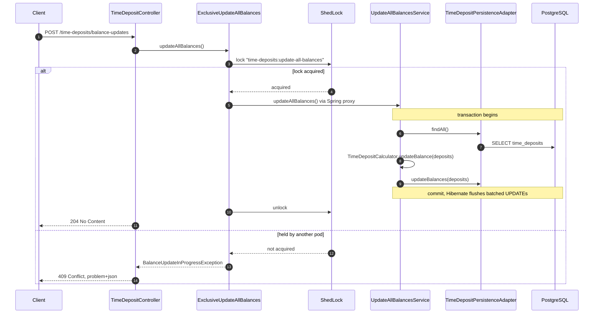

# XA Bank Time Deposit — Java solution

Spring Boot 3.5 / Java 17 service that exposes the time-deposit domain over REST, persists it in
PostgreSQL and keeps `TimeDepositCalculator.updateBalance` bit-for-bit compatible with the original code.

## Prerequisites

- JDK 17+
- Maven 3.9+
- Docker (for running the app locally via Compose and for the Testcontainers integration tests)

## Build and test

```bash
cd java
mvn test      # unit + characterization + web-slice + architecture tests (no Docker needed)
mvn verify    # additionally runs *IT integration tests against PostgreSQL in Testcontainers
```

## Test coverage

`mvn verify` produces a JaCoCo report for unit **and** Testcontainers integration tests together:
`target/site/jacoco/index.html` (HTML) and `target/site/jacoco/jacoco.xml` (for CI tools).
Code generated from the OpenAPI contract, MapStruct implementations, Lombok-generated members and the Spring Boot
main class are excluded, so the numbers describe hand-written code only.

Coverage is used as a guide only: no minimum percentage is enforced. A high percentage doesn't mean the tests are
good - every test here has a clear purpose and should catch a real defect. The strongest guarantee for the interest
logic is not coverage but the golden-master comparison with the original implementation.

## Run

```bash
cd java
mvn spring-boot:run
```

`spring-boot-docker-compose` starts PostgreSQL from `compose.yaml`; Flyway creates the schema and loads
demo data (`src/main/resources/db/sample-data`): one deposit per interesting rule case, plus withdrawals.

To use an existing PostgreSQL instead, set `SPRING_DOCKER_COMPOSE_ENABLED=false` and
`SPRING_DATASOURCE_URL` / `_USERNAME` / `_PASSWORD`.

## Trigger the endpoints with Swagger

1. Open **http://localhost:8080/swagger-ui.html**. It renders the contract
   `src/main/resources/static/openapi/time-deposit-api.yaml` — the same file the server code is generated from.
2. **GET `/time-deposits`** → *Try it out* → *Execute*. Returns all deposits with `id`, `planType`, `balance`,
   `days` and `withdrawals`.
3. **POST `/time-deposits/balance-updates`** → *Try it out* → *Execute*. Returns `204 No Content`; one month of
   interest has been applied to every deposit.
4. Run the GET again to see the new balances. With the demo data:

| id | plan | days | before | after one update |
|---|---|---|---|---|
| 1 | basic | 30 | 10000.00 | 10000.00 (grace period) |
| 2 | basic | 31 | 10000.00 | 10008.33 |
| 3 | student | 365 | 5000.00 | 5012.50 |
| 4 | student | 366 | 5000.00 | 5000.00 (after one year) |
| 5 | premium | 45 | 20000.00 | 20000.00 (starts after 45 days) |
| 6 | premium | 46 | 20000.00 | 20083.33 |
| 7 | gold | 100 | 1000.00 | 1000.00 (unknown plan) |

Same with curl:

```bash
curl -s http://localhost:8080/time-deposits
curl -s -X POST -i http://localhost:8080/time-deposits/balance-updates
```

Swagger UI and `/v3/api-docs` are documentation served by springdoc, not API endpoints. The API itself has
exactly the two operations above.

## Architecture

Hexagonal (ports & adapters). Dependencies point inwards and are enforced by `ArchitectureTest` (ArchUnit).



Spring is used in the adapters and, as stereotypes and `@Transactional` only, in the application layer. The domain
stays Spring-free; `config.DomainConfiguration` registers `TimeDepositCalculator` as a bean.

### Interest calculation

`TimeDepositCalculator.updateBalance(List<TimeDeposit>)` keeps its signature and behaviour; the `if/else`
chain was replaced by the **Strategy** pattern:

- `InterestPolicy` — one strategy per plan type, returns the unrounded monthly interest.
- `AnnualRateInterestPolicy` — **Template Method** for "annual rate / 12 after a 30-day grace period",
  with a hook `accruesInterestOn(days)` for plan-specific rules.
- `BasicPlanInterestPolicy`, `StudentPlanInterestPolicy`, `PremiumPlanInterestPolicy`.
- `InterestPolicies` — registry; unknown plan types resolve to `InterestPolicy.NO_INTEREST`.
- The hierarchy is **sealed** (`InterestPolicy` → `AnnualRateInterestPolicy`, `NoInterestPolicy`;
  `AnnualRateInterestPolicy` → the three plans): the plan catalogue is closed and every implementation is known.



A new plan is one new class, its name in the parent's `permits` clause and one line in
`InterestPolicies.defaults()`; the calculator and the logic of existing policies do not change. Rules that need more
than "rate / 12" implement `InterestPolicy` directly.

### Concurrent balance updates (several pods)

`POST /time-deposits/balance-updates` runs under a cluster-wide lock, so two overlapping calls - on the same pod or
on different Kubernetes pods - can never both credit interest:

- Port `DistributedLock` (application layer), implemented by `ShedLockDistributedLockAdapter` with
  [ShedLock](https://github.com/lukas-krecan/ShedLock) and its `shedlock` table in the shared PostgreSQL
  (migration `V2__create_shedlock.sql`). Lock timestamps use database time, so pod clock skew does not matter.
- `ExclusiveUpdateAllBalances` wraps the *transactional* use case: lock -> transaction -> update. The lock is
  released only after the new balances are committed, so the next caller always sees them.
- The second caller does not wait (after waiting it would credit a second month): it gets `409 Conflict` with an
  RFC 9457 problem body, and nothing is changed.
- If a pod dies while holding the lock, the lock expires after `time-deposit.lock.at-most-for` (default 10 minutes);
  this value must exceed the longest expected balance update.
- `TimeDepositApiIT` proves it against real PostgreSQL by inserting the lock row of "another pod".



The lock prevents *overlapping* calls only. Two calls one after the other still credit two months - the endpoint is
deliberately not idempotent (see assumptions).

### How behaviour preservation is proven

- `LegacyTimeDepositCalculator` (test sources) is a verbatim copy of the original method.
- `TimeDepositCalculatorCharacterizationTest` compares the raw `double` bits of the new and legacy results on
  every boundary day of every plan, on 20 000 random deposits and over 36 consecutive monthly updates.
- `TimeDepositCalculatorTest` is the readable specification with expected values taken from the original code,
  including the rounding quirk: `new BigDecimal(double)` turns 0.015 into 0.01, so it is kept on purpose.

## Assumptions

Each is also documented as an `ASSUMPTION:` comment where the decision is made.

- Rates are annual and paid monthly (`balance * rate / 12`) — this is what the existing, "correct" code does,
  although the README just says "1% interest".
- Student: interest up to and including day 365. Premium: from day 46. All plans: from day 31.
- Unknown plan types earn nothing; plan types are case-sensitive.
- The balance update changes balances only, `days` is not incremented (the original method never did).
- The update endpoint is not idempotent: each call credits one more month. It is intended to be triggered
  monthly by a scheduler.
- Withdrawals are read-only history and do not influence interest (no rule for that is given).
- Persistence uses Spring Data JPA with separate entities (`TimeDepositEntity`, `WithdrawalEntity`) mapped to the
  domain by MapStruct: the shared `TimeDeposit` class cannot carry JPA annotations or a no-arg constructor without
  breaking changes. Flyway owns the schema, Hibernate runs with `ddl-auto=validate`.
- Physical table/column names are snake_case (`time_deposits.plan_type`, …) following PostgreSQL convention;
  the mapping to the logical names from the task is in `V1__create_time_deposits_and_withdrawals.sql`.
- Money is `NUMERIC(19,2)` in the database and `number` with 2 decimals in the API; the legacy domain keeps
  `Double`, conversion happens only in the adapters.
- Invalid input and error handling are out of scope, as stated in the task.
